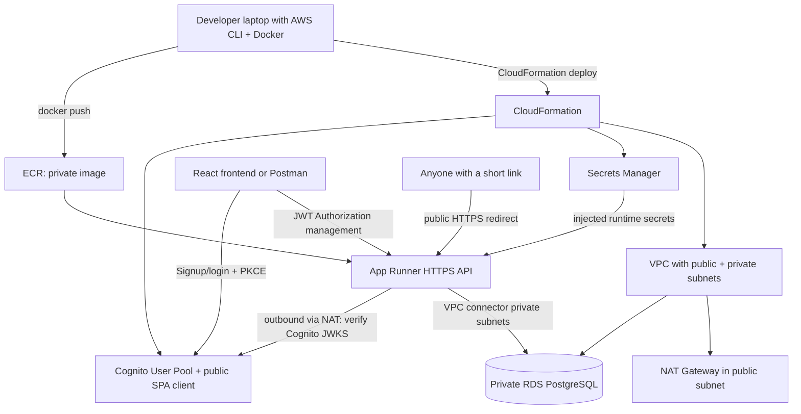

# Fully command-driven AWS deployment architecture

Two **independent deployments** are supported: `deploy.sh node`. They create separate infrastructure, RDS databases, Cognito user pools and ECR image stacks by default because the JavaScript and Java database migrations use different schemas.

**Call flow:** Sign-in -> Cognito access token -> POST `/api/v1/links` -> validate destination & expiry -> transactional PostgreSQL insert -> respond with public HTTPS short URL. GET `/{code}` -> check expiry/revocation in PostgreSQL atomically -> store click event -> return 302. Expired/revoked codes yield 410. `GET /health` is application health; `GET /ready` checks database connectivity.

**DevOps flow:** `deploy.sh` -> validate templates -> create infrastructure -> Docker build (linux/amd64) -> immutable ECR push -> App Runner service -> read AWS-created public domain -> update BASE_URL -> smoke tests. Every deploy updates code while preserving RDS data. No cloud resources are created unless the user runs AWS CLI using their own AWS credentials.

**Operational caveats:** AWS App Runner is internet reachable immediately, so don't deploy unsafe sample secrets or code. Account charges begin at infrastructure creation. CloudFormation snapshot retention prevents automatic hard-delete of the final DB snapshot. See `AWS_DEPLOYMENT_COMMANDS.md` for explicit limitations and teardown steps.
